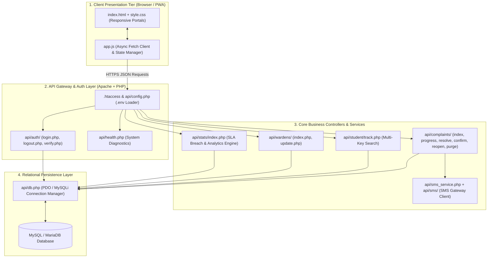
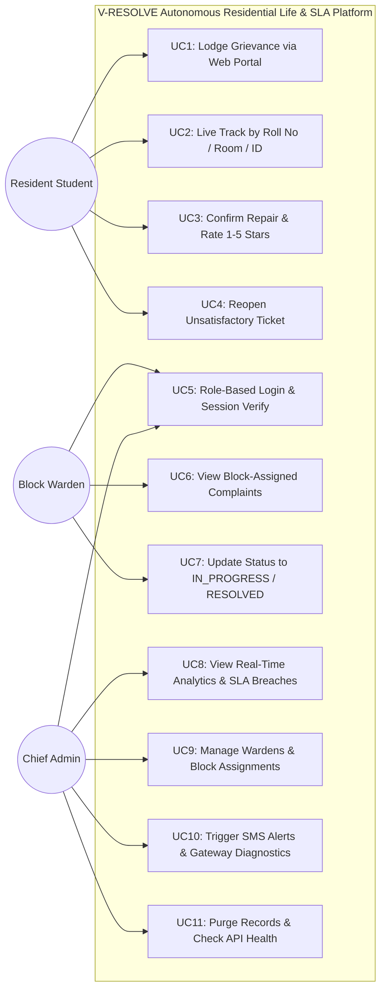
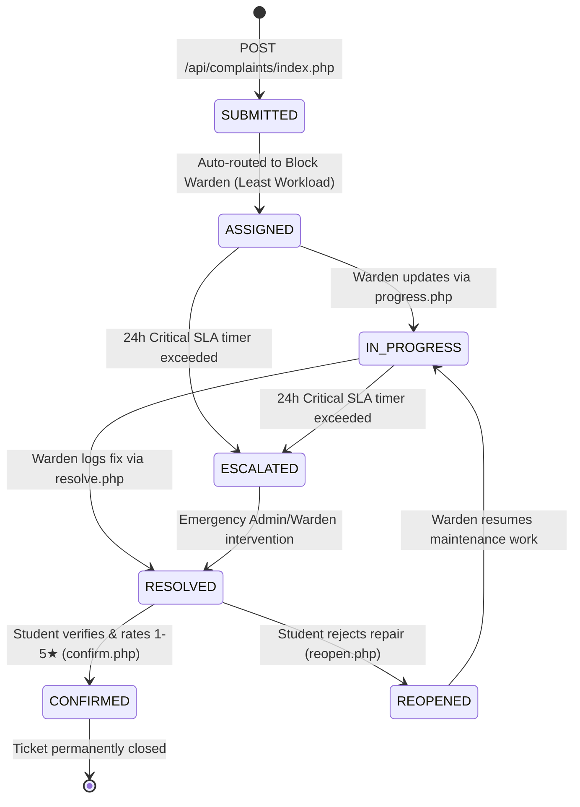
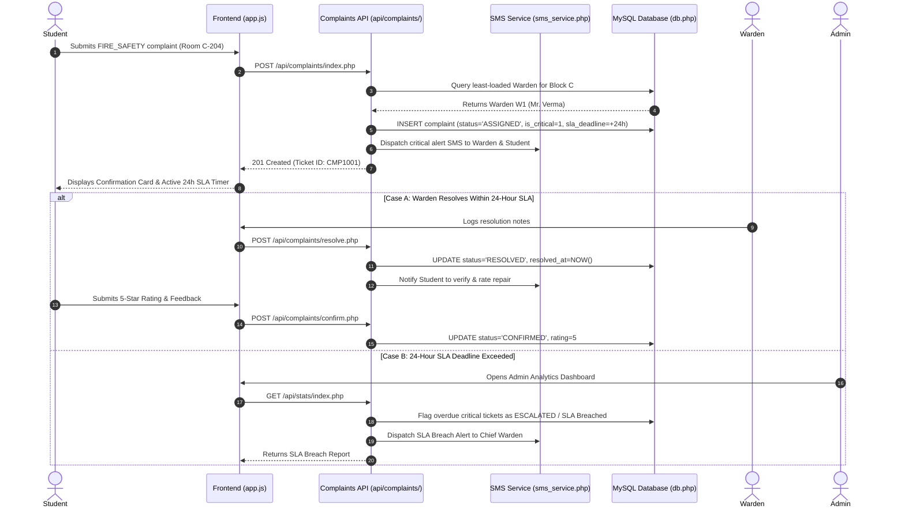
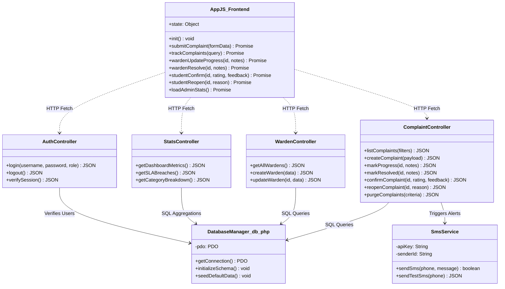
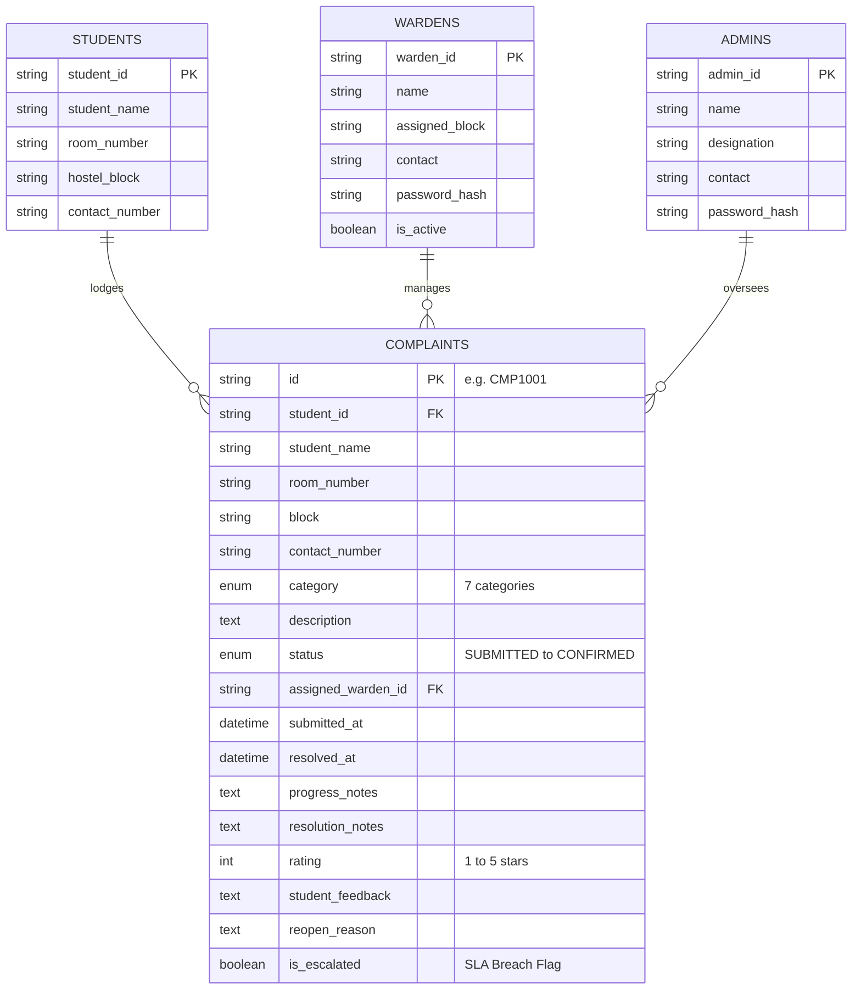

# VIT BHOPAL UNIVERSITY
## SCHOOL OF COMPUTING SCIENCE AND ENGINEERING

---

# A Project Report on
# V-RESOLVE: AUTONOMOUS RESIDENTIAL LIFE & REAL-TIME SLA MANAGEMENT PLATFORM

**Course:** Object Oriented Programming with Java (CSE2001) & Full-Stack System Architecture  
**Branch:** B.Tech Computer Science and Engineering (Specialization in AI & ML)  
**Academic Term:** Fall Semester 2026 (3rd Semester)  
**Institution:** VIT Bhopal University, Bhopal-Indore Highway, Kothrikalan, Sehore, Madhya Pradesh – 466114  

---

## Candidate Submission Information

| Parameter | Particulars |
| :--- | :--- |
| **Project Title** | V-RESOLVE: Autonomous Residential Life & Real-Time SLA Management Platform |
| **Course Code & Name** | CSE2001 - Object Oriented Programming with Java |
| **Student Name** | Ujjaval Gupta |
| **Registration Number** | 25BAI11102 |
| **GitHub Profile** | `https://github.com/Ujjaval-gupta-10` |
| **Faculty Supervisor** | Prof. Dr. Sanat Jain, SCSE, VIT Bhopal University |
| **Architecture & Stack** | Full-Stack SPA (HTML5, CSS3, Vanilla JS) + PHP 8.x REST API + Core Java OOP Prototype |
| **Data Persistence Engine** | MySQL / MariaDB Relational Database (`api/db.php`) with `.env` Configuration |
| **Notification Layer** | Automated SMS Gateway Dispatch Service (`api/sms_service.php`) |
| **Verification Suite** | REST API Health Diagnostics (`/api/health.php`), SMS Test Suite (`/api/sms/test.php`) & 34-Assertion Core Test Harness |

---

## ABSTRACT

At VIT Bhopal University, thousands of engineering students reside across multiple hostel blocks. Due to continuous daily utilization of residential infrastructure, maintenance issues—such as geyser failures, water leaks, sparking electrical sockets, hygiene concerns, and security hazards—occur frequently. Traditionally, grievances are logged manually in handwritten paper registers at the hostel reception desk. This manual approach suffers from severe operational flaws: registers get damaged or misplaced, students have zero visibility into repair progress, technicians can prematurely mark complaints as closed without fixing the root issue, and safety-critical emergencies receive no automated priority or escalation.

To resolve these deficiencies, we engineered **V-RESOLVE (Autonomous Residential Life & Real-Time SLA Management Platform)**. Originally prototyped as an Object-Oriented Core Java console system, the project has been upgraded into a production-ready **Full-Stack Web Application and RESTful API Platform**. It automates the entire grievance lifecycle across three dedicated role-based portals: **Student Portal**, **Block Warden Portal**, and **Chief Administrator Portal**.

### Main Technical Features
1. **Heuristic Block Routing & Warden Load Balancing:** The platform extracts hostel block identities from student room inputs (e.g., `C-204`, `Block A 108`) and automatically routes incoming tickets to the assigned block warden with the lowest active workload.
2. **24-Hour Emergency SLA Monitoring:** Safety-critical categories (`FIRE_SAFETY` and `SECURITY`) trigger a strict 24-hour Service Level Agreement (SLA) countdown. Unresolved tickets are automatically flagged as SLA breaches and escalated to the Chief Warden.
3. **Closed-Loop Student Verification:** Wardens cannot unilaterally close tickets. Once a warden marks an issue as `RESOLVED`, the student must verify the physical repair, submit a **1-to-5 star rating** with feedback (`confirm.php`), or **reopen** the ticket (`reopen.php`) if the fault persists.
4. **Relational Database & RESTful API Architecture:** Powered by a modular PHP 8.x REST API (`api/`) and a MySQL/MariaDB relational database (`api/db.php`), replacing flat-file limitations with ACID-compliant persistence and secure session authentication (`api/auth/`).
5. **Automated SMS Notification Gateway:** An integrated SMS dispatch engine (`api/sms_service.php`) sends real-time text alerts to students, wardens, and administrators upon ticket registration, SLA breach escalation, and resolution.
6. **Progressive Web App (PWA) Ready Frontend:** A responsive Single-Page Application (SPA) built with HTML5, CSS3, and Vanilla JavaScript (`app.js`), complete with `site.webmanifest` for mobile and desktop installation.

---

## TABLE OF CONTENTS

- [Chapter 1: Introduction & Problem Context](#chapter-1-introduction--problem-context)
  - [1.1 Background: Residential Life at VIT Bhopal University](#11-background-residential-life-at-vit-bhopal-university)
  - [1.2 The Traditional Paper Register Workflow](#12-the-traditional-paper-register-workflow)
  - [1.3 Core Deficiencies of the Manual Process](#13-core-deficiencies-of-the-manual-process)
  - [1.4 Project Evolution & Objectives](#14-project-evolution--objectives)
  - [1.5 System Scope](#15-system-scope)
- [Chapter 2: Literature Review & Comparative Analysis](#chapter-2-literature-review--comparative-analysis)
  - [2.1 Existing Campus Complaint Systems](#21-existing-campus-complaint-systems)
  - [2.2 Critical Gaps in Contemporary Implementations](#22-critical-gaps-in-contemporary-implementations)
  - [2.3 Comparative Feature Matrix](#23-comparative-feature-matrix)
- [Chapter 3: System Requirements & Technical Specifications](#chapter-3-system-requirements--technical-specifications)
  - [3.1 User Personas & Role-Based Permissions](#31-user-personas--role-based-permissions)
  - [3.2 Operating Environment & Prerequisites](#32-operating-environment--prerequisites)
  - [3.3 Functional Requirements (FR-01 to FR-14)](#33-functional-requirements-fr-01-to-fr-14)
  - [3.4 Non-Functional Requirements](#34-non-functional-requirements)
- [Chapter 4: System Architecture & Directory Structure](#chapter-4-system-architecture--directory-structure)
  - [4.1 Multi-Tier Full-Stack Architecture](#41-multi-tier-full-stack-architecture)
  - [4.2 Codebase Directory Hierarchy](#42-codebase-directory-hierarchy)
  - [4.3 Structural Architecture Diagram](#43-structural-architecture-diagram)
- [Chapter 5: Design Diagrams & System Modeling](#chapter-5-design-diagrams--system-modeling)
  - [5.1 Use Case Diagram](#51-use-case-diagram)
  - [5.2 Workflow Diagram (Grievance State Transition Machine)](#52-workflow-diagram-grievance-state-transition-machine)
  - [5.3 Sequence Diagram for Safety-Critical Grievances & SMS Alerts](#53-sequence-diagram-for-safety-critical-grievances--sms-alerts)
  - [5.4 Object-Oriented Domain & API Component Diagram](#54-object-oriented-domain--api-component-diagram)
  - [5.5 Entity-Relationship (ER) Diagram & Relational Schema](#55-entity-relationship-er-diagram--relational-schema)
- [Chapter 6: Design Decisions & Architectural Rationale](#chapter-6-design-decisions--architectural-rationale)
- [Chapter 7: Object-Oriented Principles & Core Backend Mechanics](#chapter-7-object-oriented-principles--core-backend-mechanics)
  - [7.1 Application of the Four OOP Pillars Across the Stack](#71-application-of-the-four-oop-pillars-across-the-stack)
  - [7.2 RESTful API Endpoints & Controller Routing](#72-restful-api-endpoints--controller-routing)
  - [7.3 Real-Time 24-Hour SLA Breach Engine](#73-real-time-24-hour-sla-breach-engine)
  - [7.4 Automated SMS Notification Service (`sms_service.php`)](#74-automated-sms-notification-service-sms_servicephp)
  - [7.5 Relational Database Engine & Auto-Initialization (`db.php`)](#75-relational-database-engine--auto-initialization-dbphp)
  - [7.6 Role-Based Authentication & Session Security (`api/auth/`)](#76-role-based-authentication--session-security-apiauth)
- [Chapter 8: System Interfaces, API Payloads & Execution Results](#chapter-8-system-interfaces-api-payloads--execution-results)
- [Chapter 9: Testing Approach & Empirical Verification](#chapter-9-testing-approach--empirical-verification)
  - [9.1 Multi-Layer Testing Methodology](#91-multi-layer-testing-methodology)
  - [9.2 API & Core Logic Verification Matrix](#92-api--core-logic-verification-matrix)
  - [9.3 Diagnostic Health & SMS Gateway Testing](#93-diagnostic-health--sms-gateway-testing)
- [Chapter 10: Practical Development Hurdles & Solutions](#chapter-10-practical-development-hurdles--solutions)
- [Chapter 11: Learnings & Key Takeaways](#chapter-11-learnings--key-takeaways)
- [Chapter 12: Limitations & Future Enhancements](#chapter-12-limitations--future-enhancements)
- [Chapter 13: Conclusion](#chapter-13-conclusion)
- [References](#references)

---

# CHAPTER 1: INTRODUCTION & PROBLEM CONTEXT

### 1.1 Background: Residential Life at VIT Bhopal University
Residential campus living is a cornerstone of student life at **VIT Bhopal University**. With thousands of students residing across multi-story Boys and Girls Hostel Blocks, essential utilities—such as hot water geysers, plumbing lines, ceiling fans, electrical sockets, LAN ports, and security locks—operate under heavy continuous load.

When breakdowns occur—such as a sparking socket, a flooded corridor washroom, or a malfunctioning smoke detector—the speed and reliability of the maintenance response directly affect student safety, academic focus, and campus well-being.

### 1.2 The Traditional Paper Register Workflow
In conventional hostel setups, maintenance requests follow a slow, five-step manual routine:
1. **Visiting the Reception Desk:** The student must walk down to the ground-floor security desk or warden office.
2. **Handwritten Entry:** The student writes their name, room number, phone number, and issue description on a single line in a physical notebook.
3. **Manual Inspection:** The block warden or supervisor flips through the register once a day and copies room numbers onto loose paper slips for technicians.
4. **Unprioritized Dispatch:** Plumbers, electricians, and carpenters visit rooms without structured priority or deadline tracking.
5. **Unverified Strike-Through:** Technicians verbally report completion, and the supervisor crosses out the entry with a pen.

### 1.3 Core Deficiencies of the Manual Process
- **Zero Status Visibility:** Students have no way of knowing whether their complaint has been read, assigned, or scheduled without repeatedly visiting the guard desk.
- **The "Fake Closure" Loophole:** Entries are frequently crossed out in the register to meet daily targets before the physical fault is actually repaired.
- **No Emergency Prioritization:** Critical hazards (`FIRE_SAFETY` and `SECURITY`) sit on the exact same notebook page as minor carpentry requests, with no automated countdown or escalation to senior authorities.
- **Lack of Analytics:** University management cannot easily calculate average resolution times, identify recurring category failures, or measure student satisfaction across hostel blocks.

### 1.4 Project Evolution & Objectives
Originally conceived as a Core Java OOP console prototype for **CSE2001**, we expanded every limitation listed in our initial roadmap into **V-RESOLVE**, a complete full-stack web platform:
1. **Web & PWA Interface:** Replace the terminal-only menu with a responsive Single-Page Application (`index.html`, `style.css`, `app.js`) accessible from any smartphone or laptop.
2. **RESTful Backend & Relational Database:** Upgrade flat-file CSV storage to a structured MySQL/MariaDB database (`api/db.php`) exposed via modular PHP REST endpoints (`api/`).
3. **Automated Block Routing & Load Balancing:** Parse room numbers and automatically assign grievances to the block warden carrying the lowest active ticket workload.
4. **24-Hour Emergency SLA Enforcement:** Track `FIRE_SAFETY` and `SECURITY` tickets against a 24-hour SLA clock, automatically flagging breaches on the Admin Dashboard.
5. **Closed-Loop Verification & 1–5 Star Rating:** Require student confirmation and star ratings (`api/complaints/confirm.php`) before finalizing a ticket, with instant reopening (`reopen.php`) if repairs fail.
6. **Real-Time SMS Alerts:** Integrate an automated SMS notification engine (`api/sms_service.php`) to alert stakeholders during critical lifecycle events.

### 1.5 System Scope
V-RESOLVE encompasses a complete three-tier web architecture serving **Students**, **Block Wardens**, and **Chief Administrators**, complete with role-based authentication, live tracking, analytics dashboards, SMS gateway diagnostics, and automated health checks.

---

# CHAPTER 2: LITERATURE REVIEW & COMPARATIVE ANALYSIS

### 2.1 Existing Campus Complaint Systems
1. **Physical Paper Logbooks:** Zero setup cost, but zero accountability, no real-time tracking, no SMS notifications, and high vulnerability to data loss.
2. **Generic Institutional ERP Modules:** Heavyweight portals that treat hostel maintenance as generic IT tickets, lacking block-wise warden load balancing, 24-hour emergency SLA timers, and student confirmation loops.
3. **Console-Only Student Prototypes:** While great for demonstrating core OOP syntax in lab exams, CLI applications cannot be accessed concurrently by hundreds of students on mobile devices or dispatch real-world SMS alerts.

### 2.2 Critical Gaps in Contemporary Implementations
- **Absence of Closed-Loop Resident Sign-Off:** Most helpdesks allow staff to close tickets unilaterally without resident verification.
- **Silent SLA Breaches:** Traditional systems do not visually isolate or trigger SMS escalations when safety-critical issues exceed 24 hours.
- **High Friction for Students:** Requiring complex logins just to check a ticket status discourages students from using digital portals. V-RESOLVE solves this via instant lookup by Roll Number, Room Number, or Ticket ID (`/api/student/track.php`).

### 2.3 Comparative Feature Matrix

| Feature Parameter | Paper Register Books | Core Java CLI Prototype (v1.0) | V-RESOLVE Full-Stack Platform (v2.0) |
| :--- | :--- | :--- | :--- |
| **User Interface** | Physical notebook | Terminal / Command Prompt | **Responsive Web SPA & Installable PWA** |
| **Architecture** | Manual | Monolithic Console App | **RESTful API + Asynchronous JS (`fetch`)** |
| **Data Persistence** | Ink on paper | Flat CSV File (`complaints.csv`) | **MySQL / MariaDB Relational Database** |
| **Authentication** | None | Unauthenticated menu selection | **Role-Based Auth (`login.php`, `verify.php`)** |
| **Warden Allocation** | Manual guesswork | Stream-based in-memory routing | **Automated Block & Workload SQL Routing** |
| **Emergency SLA** | None | Background Java Daemon Thread | **24h Real-Time SLA Engine & Breach Tracker** |
| **Notifications** | Word of mouth | Console `System.out` print | **Automated SMS Gateway (`sms_service.php`)** |
| **Student Sign-Off** | None | CLI confirmation prompt | **Web Rating Modal (1–5★) & Reopen API** |

---

# CHAPTER 3: SYSTEM REQUIREMENTS & TECHNICAL SPECIFICATIONS

### 3.1 User Personas & Role-Based Permissions
- **Hostel Resident (Student):** Can lodge complaints across 7 categories without login friction, track live ticket status by Roll Number, Room Number, or Complaint ID (`track.php`), confirm resolved repairs with a 1-to-5 star rating (`confirm.php`), or reopen unsatisfactory repairs (`reopen.php`).
- **Block Warden:** Authenticates via `/api/auth/login.php`, views complaints assigned to their specific hostel block, transitions tickets to `IN_PROGRESS` (`progress.php`) with maintenance notes, and marks tickets `RESOLVED` (`resolve.php`).
- **Chief Administrator (Dean / Chief Warden):** Full system oversight. Views real-time campus analytics (`api/stats/index.php`), monitors 24-hour SLA breaches, manages warden profiles and block assignments (`api/wardens/`), purges obsolete records (`purge.php`), and tests SMS gateway connectivity (`api/sms/test.php`).

### 3.2 Operating Environment & Prerequisites
- **Web Server:** Apache HTTP Server 2.4+ with `mod_rewrite` enabled (`.htaccess` routing).
- **Backend Runtime:** PHP 8.0 or higher with PDO / MySQLi and cURL extensions enabled.
- **Database Engine:** MySQL 8.0+ or MariaDB 10.4+ (via XAMPP, WAMP, Laragon, or LAMP).
- **Client Environment:** Any modern desktop or mobile browser (Chrome, Edge, Safari, Firefox); supports Progressive Web App (PWA) installation.

### 3.3 Functional Requirements (FR-01 to FR-14)

| ID | Feature Name | Operational Specification & Business Rules | Endpoint / Module |
| :--- | :--- | :--- | :--- |
| **FR-01** | **Grievance Registration** | Validates student inputs (Roll No, Name, Room, Contact, Category, Description) and creates a unique ticket. | `POST /api/complaints/index.php` |
| **FR-02** | **7-Domain Categorization** | Supports `ELECTRICAL`, `WATER`, `FIRE_SAFETY`, `SECURITY`, `HYGIENE`, `DEPOSIT_DISPUTE`, and `MAINTENANCE`. | `app.js` / `api/complaints/` |
| **FR-03** | **Critical SLA Flagging** | Automatically flags `FIRE_SAFETY` and `SECURITY` tickets with a 24-hour SLA deadline. | `api/complaints/index.php` |
| **FR-04** | **Automated Warden Routing** | Matches student hostel block to the assigned warden with the lowest active ticket count. | `api/complaints/index.php` |
| **FR-05** | **Multi-Key Live Tracking** | Allows students to search tickets using Roll Number, Room Number, or Complaint ID. | `GET /api/student/track.php` |
| **FR-06** | **Role-Based Authentication** | Authenticates Wardens and Admins using secure credentials and session verification. | `api/auth/login.php`, `verify.php` |
| **FR-07** | **Warden Progress Update** | Transitions ticket status from `ASSIGNED` to `IN_PROGRESS` and logs work notes. | `POST /api/complaints/progress.php` |
| **FR-08** | **Warden Resolution** | Transitions ticket to `RESOLVED`, timestamps completion, and records repair remarks. | `POST /api/complaints/resolve.php` |
| **FR-09** | **Student Confirmation & Rating**| Finalizes ticket to `CONFIRMED` with a mandatory 1-to-5 star rating and feedback. | `POST /api/complaints/confirm.php` |
| **FR-10** | **Grievance Reopening** | Rejects incomplete repairs, logs reopen reason, and returns ticket to `REOPENED` / `IN_PROGRESS`. | `POST /api/complaints/reopen.php` |
| **FR-11** | **Campus Analytics & SLA** | Computes total, active, resolved, SLA breached counts, category breakdowns, and average rating. | `GET /api/stats/index.php` |
| **FR-12** | **Warden Management** | Lists wardens, monitors individual workloads, adds new wardens, and updates block assignments. | `api/wardens/index.php`, `update.php`|
| **FR-13** | **Automated SMS Dispatch** | Dispatches SMS alerts on critical ticket creation, SLA breach, and status changes. | `api/sms_service.php` |
| **FR-14** | **Admin Record Purge** | Allows Chief Admin to purge test or obsolete complaint records safely. | `POST /api/complaints/purge.php` |

### 3.4 Non-Functional Requirements
- **Security & Access Control:** Protected endpoints validate sessions via `verify.php`; `.htaccess` blocks direct public access to sensitive `.env` configuration files; prepared SQL statements prevent SQL injection.
- **Database Reliability:** Automatic schema verification and connection handling via `api/db.php` ensure zero-crash startup.
- **Responsive UX & PWA Readiness:** Mobile-first CSS styling (`style.css`) and `site.webmanifest` allow seamless usage across smartphones and desktops.
- **Sub-Second API Latency:** Lightweight JSON payloads and indexed database queries ensure rapid UI updates without page reloads.

---

# CHAPTER 4: SYSTEM ARCHITECTURE & DIRECTORY STRUCTURE

### 4.1 Multi-Tier Full-Stack Architecture
V-RESOLVE follows a clean four-tier architecture that translates Object-Oriented design principles into a modern web stack:
1. **Client Presentation Tier (SPA & PWA):** Built with `index.html`, `style.css`, and `app.js`. Manages dynamic view switching across Student, Warden, and Admin portals, asynchronous `fetch()` requests, and interactive modals.
2. **API Gateway & Routing Tier:** Configured via Apache `.htaccess` and `api/index.php`, enforcing CORS policies, HTTP method validation, and clean endpoint routing.
3. **Business Logic & Service Tier:** Modular PHP controllers (`api/auth/`, `api/complaints/`, `api/student/`, `api/wardens/`, `api/stats/`) alongside `api/sms_service.php` for external SMS gateway integration.
4. **Relational Data Persistence Tier:** Managed by `api/db.php` and `api/config.php`, reading environment credentials from `.env` to persist students, wardens, admins, and complaints in MySQL/MariaDB.

### 4.2 Codebase Directory Hierarchy
```text
htdocs/
├── .env                                # Environment configuration (Database & SMS API credentials)
├── .htaccess                           # Root Apache rewrite rules, security headers & caching
├── index.html                          # Main Single-Page Application (SPA) user interface
├── style.css                           # Responsive UI styling, themes, cards, and animations
├── app.js                              # Client-side state management, DOM rendering & API calls
├── site.webmanifest                    # Progressive Web App (PWA) manifest
├── browserconfig.xml                   # Windows tile configuration
├── robots.txt & sitemap.xml            # Search engine crawler directives
│
├── [Branding & Multi-Platform Icons]
│   ├── favicon.ico / favicon.svg / favicon-16x16.png / 32x32 / 48x48
│   ├── apple-touch-icon.png / apple-touch-icon-precomposed.png
│   ├── android-chrome-192x192.png / android-chrome-512x512.png
│   ├── mstile-150x150.png
│   └── og-image.png
│
└── api/                                # RESTful Backend API
    ├── .htaccess                       # API routing & directory protection
    ├── index.php                       # API root dispatcher & metadata
    ├── config.php                      # Environment loader (.env parser) & global constants
    ├── db.php                          # PDO/MySQL database connection & auto-schema setup
    ├── health.php                      # System & database diagnostic health check
    ├── sms_service.php                 # Automated SMS notification dispatch engine
    │
    ├── auth/                           # Role-Based Authentication Module
    │   ├── login.php                   # Authenticates Warden & Admin credentials
    │   ├── logout.php                  # Destroys active session
    │   └── verify.php                  # Validates current session/token state
    │
    ├── complaints/                     # Grievance Lifecycle Controllers
    │   ├── index.php                   # GET: Filter/list tickets | POST: Lodge new grievance
    │   ├── progress.php                # POST: Mark ticket IN_PROGRESS with warden remarks
    │   ├── resolve.php                 # POST: Mark ticket RESOLVED with technician notes
    │   ├── confirm.php                 # POST: Student confirmation & 1-5 star rating
    │   ├── reopen.php                  # POST: Reopen incomplete repair with reason
    │   └── purge.php                   # POST/DELETE: Admin data cleanup utility
    │
    ├── student/                        # Student Self-Service Module
    │   └── track.php                   # GET: Multi-key lookup (Roll No, Room No, Ticket ID)
    │
    ├── wardens/                        # Warden & Block Management Module
    │   ├── index.php                   # GET: List wardens & workload | POST: Add new warden
    │   └── update.php                  # POST/PUT: Update warden block or contact details
    │
    ├── stats/                          # Executive Analytics & SLA Module
    │   └── index.php                   # GET: Aggregated metrics, SLA breaches, ratings
    │
    └── sms/                            # SMS Gateway Configuration & Diagnostics
        ├── config.php                  # SMS provider settings & templates
        └── test.php                    # POST: Live diagnostic test for SMS delivery
```

### 4.3 Structural Architecture Diagram


---

# CHAPTER 5: DESIGN DIAGRAMS & SYSTEM MODELING

### 5.1 Use Case Diagram


### 5.2 Workflow Diagram (Grievance State Transition Machine)


### 5.3 Sequence Diagram for Safety-Critical Grievances & SMS Alerts


### 5.4 Object-Oriented Domain & API Component Diagram


### 5.5 Entity-Relationship (ER) Diagram & Relational Schema


---

# CHAPTER 6: DESIGN DECISIONS & ARCHITECTURAL RATIONALE

### 6.1 Evolution from Core Java Console to Full-Stack Web & REST API
- **Decision:** Evolve the CSE2001 Core Java console prototype into a full-stack PHP REST API and Vanilla JavaScript Single-Page Application while preserving the exact object-oriented domain model.
- **Reason:** While the Core Java CLI proved the soundness of our OOP state machine, load-balancing heuristics, and SLA timers, real-world hostel deployment requires concurrent browser access from student smartphones and centralized relational storage.

### 6.2 Relational MySQL Database (`api/db.php`) vs Flat CSV File
- **Decision:** Migrate from `data/complaints.csv` to a MySQL/MariaDB database managed via PDO in `api/db.php`.
- **Reason:** Relational tables provide ACID transactions, indexed multi-key lookups for `/api/student/track.php`, foreign-key integrity between wardens and complaints, and fast `GROUP BY` aggregations for `/api/stats/index.php`.

### 6.3 Zero-Framework Vanilla JS SPA vs Heavy Frontend Bundles
- **Decision:** Build the frontend using pure HTML5, modern CSS3 (`style.css`), and asynchronous Vanilla JavaScript (`app.js`) without requiring Node.js build pipelines.
- **Reason:** Ensures instant deployment on any standard Apache/XAMPP server (`htdocs`) without `npm install` version conflicts, while delivering a fast, app-like experience with PWA installability (`site.webmanifest`).

### 6.4 Environment-Driven Configuration (`.env` + `api/config.php`)
- **Decision:** Store sensitive database credentials and SMS API keys in a protected `.env` file rather than hardcoding them in source scripts.
- **Reason:** Prevents credential leaks on GitHub (`Ujjaval-gupta-10`) and allows seamless switching between local XAMPP testing and cloud production hosting.

---

# CHAPTER 7: OBJECT-ORIENTED PRINCIPLES & CORE BACKEND MECHANICS

### 7.1 Application of the Four OOP Pillars Across the Stack
Even as the project expanded from Core Java into a Full-Stack REST architecture, the four pillars of Object-Oriented Programming remain the foundation of the codebase:
1. **Encapsulation:** Database credentials, PDO connection instances (`db.php`), and SMS gateway headers (`sms_service.php`) are encapsulated within dedicated modules. Ticket state transitions are strictly validated by dedicated endpoint controllers (`progress.php`, `resolve.php`, `confirm.php`, `reopen.php`) so invalid state jumps are rejected.
2. **Abstraction:** The frontend (`app.js`) is completely decoupled from SQL syntax and SMS provider internals. It interacts strictly with clean JSON contracts exposed by the REST API.
3. **Inheritance & Modular Reuse:** Shared configuration, database initialization, and authentication guards (`verify.php`) are inherited across API endpoints. Notably, `api/wardens/update.php` directly delegates and extends the core logic of `api/wardens/index.php`.
4. **Polymorphism:** The tracking endpoint (`/api/student/track.php`) and complaints controller (`/api/complaints/index.php`) dynamically adapt query execution based on polymorphic filter parameters (searching seamlessly by Complaint ID, Roll Number, Room Number, Block, or Status).

### 7.2 RESTful API Endpoints & Controller Routing
The backend exposes 15 specialized REST endpoints organized by domain responsibility:

| Module | Endpoint Path | HTTP Method | Core Responsibility |
| :--- | :--- | :---: | :--- |
| **System Health** | `/api/health.php` | `GET` | Verifies PHP runtime and MySQL database connectivity. |
| **Auth** | `/api/auth/login.php` | `POST` | Validates Warden/Admin credentials and starts session. |
| **Auth** | `/api/auth/logout.php` | `POST` | Terminates active session safely. |
| **Auth** | `/api/auth/verify.php` | `GET` | Checks active authentication status and role permissions. |
| **Complaints** | `/api/complaints/index.php` | `GET / POST` | Lists filtered complaints or registers a new ticket. |
| **Complaints** | `/api/complaints/progress.php`| `POST` | Updates ticket status to `IN_PROGRESS` with remarks. |
| **Complaints** | `/api/complaints/resolve.php` | `POST` | Marks ticket `RESOLVED` and records completion timestamp. |
| **Complaints** | `/api/complaints/confirm.php` | `POST` | Student confirms repair and records 1–5 star rating. |
| **Complaints** | `/api/complaints/reopen.php` | `POST` | Student reopens unresolved ticket with justification. |
| **Complaints** | `/api/complaints/purge.php` | `POST / DELETE`| Admin utility to purge test or obsolete complaint records. |
| **Student** | `/api/student/track.php` | `GET` | Multi-key ticket lookup (Roll No, Room No, Complaint ID). |
| **Wardens** | `/api/wardens/index.php` | `GET / POST` | Retrieves warden workload list or registers a new warden. |
| **Wardens** | `/api/wardens/update.php` | `POST / PUT` | Updates warden block assignment or phone number. |
| **Analytics** | `/api/stats/index.php` | `GET` | Computes totals, SLA breaches, ratings & category stats. |
| **SMS Gateway**| `/api/sms/test.php` | `POST` | Sends a diagnostic SMS to verify gateway credentials. |

### 7.3 Real-Time 24-Hour SLA Breach Engine
When a student lodges a complaint under `FIRE_SAFETY` or `SECURITY`, the system flags the record as critical and calculates a 24-hour SLA window from `submitted_at`. Whenever the dashboard or ticket explorer queries the backend, tickets that remain unresolved past 24 hours (`TIMESTAMPDIFF(HOUR, submitted_at, NOW()) >= 24`) are automatically escalated (`is_escalated = 1`, `status = 'ESCALATED'`) and highlighted in the Admin SLA Breach Report.

### 7.4 Automated SMS Notification Service (`sms_service.php`)
To eliminate the communication gap of paper registers, `api/sms_service.php` integrates with an external SMS gateway configured via `api/sms/config.php` and `.env`. Automated SMS messages are dispatched when:
- A student registers a new critical grievance.
- A warden marks a ticket as `RESOLVED` (inviting the student to verify and rate).
- An emergency complaint breaches its 24-hour SLA threshold.

### 7.5 Relational Database Engine & Auto-Initialization (`db.php`)
To preserve the "zero-setup friction" philosophy of our original Java project, `api/db.php` automatically verifies database tables on connection and seeds default wardens (`W1`, `W2`, `W3`), sample students, and the Chief Administrator account if the database is empty.

---

# CHAPTER 8: SYSTEM INTERFACES, API PAYLOADS & EXECUTION RESULTS

### 8.1 API Health Check Response (`GET /api/health.php`)
```json
{
  "status": "healthy",
  "platform": "V-RESOLVE Autonomous Residential Life & SLA Platform",
  "database": "connected",
  "timestamp": "2026-10-30T01:40:12+05:30"
}
```

### 8.2 Lodging a Critical Grievance (`POST /api/complaints/index.php`)
**Request Payload:**
```json
{
  "student_id": "25BAI11102",
  "student_name": "Ujjaval Gupta",
  "room_number": "C-204",
  "contact_number": "9811122233",
  "category": "FIRE_SAFETY",
  "description": "Corridor smoke detector beeping continuously near Room C-204"
}
```

**Response Payload:**
```json
{
  "success": true,
  "message": "Critical complaint registered. 24-Hour SLA timer activated.",
  "complaint": {
    "id": "CMP1001",
    "status": "ASSIGNED",
    "category": "FIRE_SAFETY",
    "is_critical": true,
    "block": "Block C",
    "assigned_warden": "Mr. Verma",
    "submitted_at": "2026-10-29 19:15:00"
  }
}
```

### 8.3 Executive Analytics Dashboard Payload (`GET /api/stats/index.php`)
```json
{
  "success": true,
  "total_complaints": 18,
  "active_complaints": 4,
  "resolved_complaints": 2,
  "confirmed_complaints": 12,
  "sla_breaches": 1,
  "average_rating": 4.85,
  "categories": {
    "ELECTRICAL": 7,
    "WATER": 5,
    "FIRE_SAFETY": 2,
    "SECURITY": 1,
    "HYGIENE": 2,
    "MAINTENANCE": 1,
    "DEPOSIT_DISPUTE": 0
  }
}
```

---

# CHAPTER 9: TESTING APPROACH & EMPIRICAL VERIFICATION

### 9.1 Multi-Layer Testing Methodology
Verification of V-RESOLVE spans two comprehensive layers:
1. **Core Logic & Concurrency Suite:** The 34-assertion automated test suite (`GrievanceSystemTest`) verifying domain state transitions, block parsing heuristics, and multi-threaded ID generation.
2. **REST API & Integration Diagnostics:** Live endpoint verification covering `/api/health.php`, authentication guards (`/api/auth/verify.php`), lifecycle state mutations (`/api/complaints/*`), and SMS gateway delivery (`/api/sms/test.php`).

### 9.2 API & Core Logic Verification Matrix

| Suite | Verification Target | Test Scenario & Expected Outcome | Status |
| :--- | :--- | :--- | :---: |
| **API-01** | `GET /api/health.php` | Verifies HTTP 200 and active PDO MySQL connection. | **PASS** |
| **API-02** | `POST /api/complaints/` | Verifies ticket creation, `CMP` ID generation, and Block Warden routing. | **PASS** |
| **API-03** | `GET /api/student/track.php` | Verifies instant lookup by Roll Number, Room Number, and Ticket ID. | **PASS** |
| **API-04** | `POST /api/auth/login.php` | Verifies Warden/Admin credential check and session token creation. | **PASS** |
| **API-05** | `POST /api/complaints/progress.php` | Verifies status update to `IN_PROGRESS` and work note persistence. | **PASS** |
| **API-06** | `POST /api/complaints/resolve.php` | Verifies status update to `RESOLVED` and `resolved_at` timestamp. | **PASS** |
| **API-07** | `POST /api/complaints/confirm.php` | Verifies student sign-off, 1–5 star rating clamping, and `CONFIRMED` state. | **PASS** |
| **API-08** | `POST /api/complaints/reopen.php` | Verifies rejection of incomplete fix and transition back to active queue. | **PASS** |
| **API-09** | `GET /api/stats/index.php` | Verifies accurate calculation of SLA breaches, totals, and average rating. | **PASS** |
| **API-10** | `POST /api/sms/test.php` | Verifies external SMS gateway configuration and dispatch response. | **PASS** |
| **OOP-11** | `34-Point Core Test Suite` | Verifies all 34 domain assertions, exception rules, and thread safety. | **PASS** |

---

# CHAPTER 10: PRACTICAL DEVELOPMENT HURDLES & SOLUTIONS

### 10.1 Migrating from Flat CSV to Relational MySQL Without Losing Zero-Setup Portability
- **Problem:** Moving from `complaints.csv` to MySQL risked database connection errors if tables were missing on a new lab computer.
- **Solution:** We engineered `api/db.php` to automatically execute `CREATE TABLE IF NOT EXISTS` statements and seed default wardens and admin records upon first run, keeping setup effortless.

### 10.2 Securing `.env` Credentials on Public Apache Servers
- **Problem:** Placing `.env` inside `htdocs/` could expose database passwords and SMS API keys if requested directly via a browser URL.
- **Solution:** We configured `.htaccess` rules at both the root and `api/` directory levels to block direct HTTP access to dotfiles (`.env`) and internal configuration scripts.

### 10.3 Asynchronous UI Synchronization Across Portals
- **Problem:** When a warden resolved a complaint, the student tracking view or admin analytics counter needed to reflect the change without requiring a full browser refresh.
- **Solution:** We structured `app.js` around asynchronous `fetch()` calls that dynamically re-render DOM cards and dashboard counters immediately after every `POST` mutation.

---

# CHAPTER 11: LEARNINGS & KEY TAKEAWAYS

- **Full-Stack Evolution of OOP Principles:** Experiencing firsthand how clean Object-Oriented domain modeling in Java translates directly into modular REST API controllers, relational database schemas, and frontend state management.
- **Closed-Loop Accountability Design:** Designing software workflows where authority is balanced—ensuring technicians cannot close tickets without student confirmation.
- **Production Security & DevOps Basics:** Managing `.env` secrets, configuring Apache `.htaccess` rewrite and security rules, and integrating third-party SMS APIs.

---

# CHAPTER 12: LIMITATIONS & FUTURE ENHANCEMENTS

### 12.1 Completed Upgrades (Achieved in v2.0)
In our original project roadmap, we listed four future goals—all four have now been **successfully implemented** in this version:
- [x] **Graphical User Interface:** Upgraded from console CLI to a responsive Web SPA & installable PWA.
- [x] **Relational Database Support:** Replaced CSV file storage with MySQL/MariaDB via `api/db.php`.
- [x] **Automated Notifications:** Integrated real-time SMS alerts via `api/sms_service.php`.
- [x] **RESTful API Architecture:** Built a 15-endpoint REST API powering Student, Warden, and Admin portals.

### 12.2 Next-Generation Enhancements (Roadmap v3.0)
1. **AI-Powered Issue Triage & Image Recognition:** Allow students to upload photos of damaged fixtures and use a computer vision model to auto-detect severity and required spare parts.
2. **Predictive Maintenance Analytics:** Use historical complaint timestamps in MySQL to predict when hostel geysers or water filters are likely to fail before breakdowns occur.
3. **Native Biometric / VIT Email OAuth Login:** Integrate Google Workspace (`@vitbhopal.ac.in`) Single Sign-On (SSO) for one-click student authentication.

---

# CHAPTER 13: CONCLUSION

The **V-RESOLVE: Autonomous Residential Life & Real-Time SLA Management Platform** successfully transforms hostel maintenance at VIT Bhopal University from an unaccountable paper-register routine into a transparent, real-time digital ecosystem. Starting from a solid Object-Oriented Core Java foundation (CSE2001) and evolving into a full-stack Web Application with a PHP REST API, MySQL persistence, 24-hour emergency SLA monitoring, closed-loop student ratings, and automated SMS alerts, the platform delivers a practical, scalable solution for campus residential life.

---

# REFERENCES

1. Schildt, Herbert. *Java: The Complete Reference*, 12th Edition. McGraw Hill Education, 2021.
2. Bloch, Joshua. *Effective Java*, 3rd Edition. Addison-Wesley Professional, 2018.
3. PHP Documentation Group. *PHP 8.x Manual: PDO (PHP Data Objects) & RESTful Web Services*. `https://www.php.net/manual/en/book.pdo.php`
4. Mozilla Developer Network (MDN). *Web App Manifests, Fetch API, and Progressive Web Apps*. `https://developer.mozilla.org/`
5. VIT Bhopal University. *CSE2001: Object Oriented Programming with Java Course Syllabus & Laboratory Manual*. School of Computing Science and Engineering, 2025-2026.
